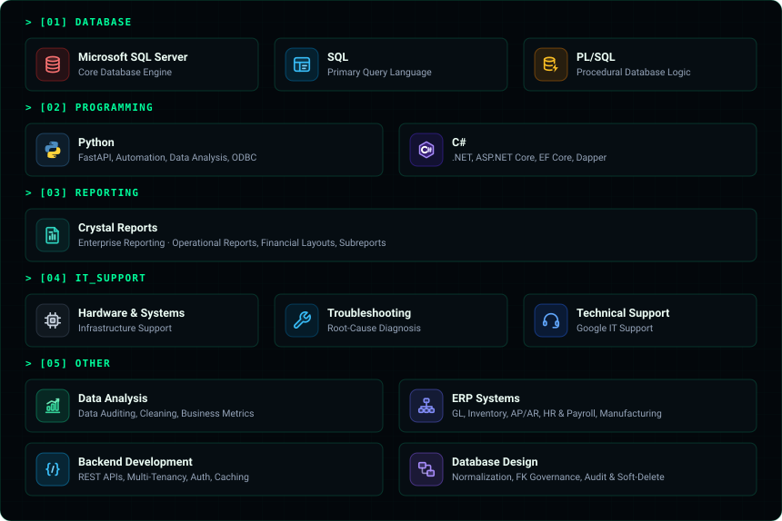
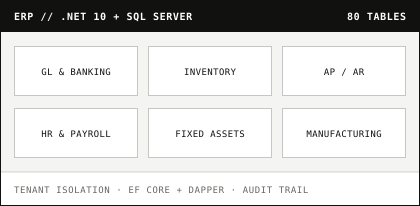
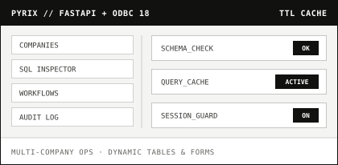
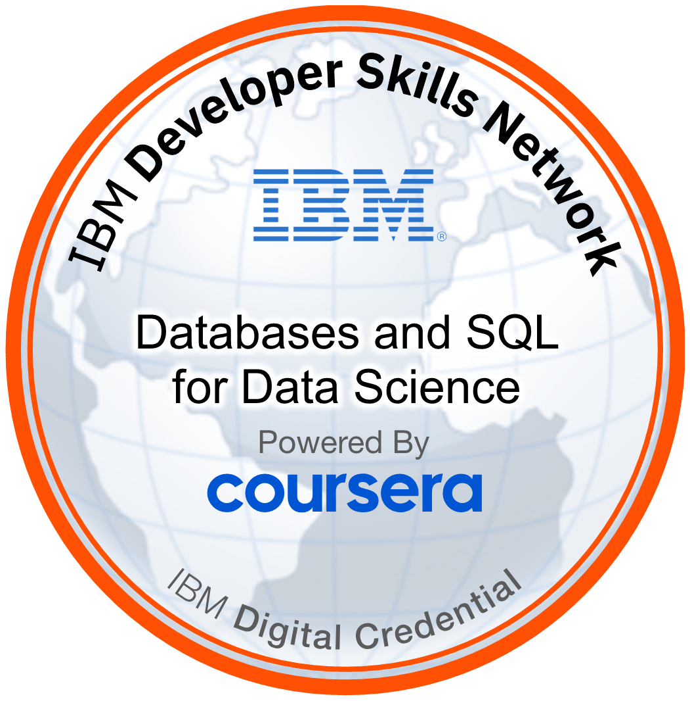
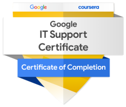
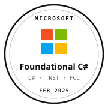
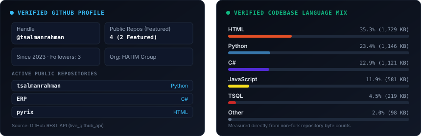

<!-- AUTO-GENERATED FILE: DO NOT EDIT MANUALLY.
     Source of truth: profile-data/*.json
     Generator: python scripts/generate_readme.py -->

  

 

### SQL Developer | Data Analyst | C# & Python Enthusiast | Google IT Support Certified

SQL Developer & Data Analyst specializing in Microsoft SQL Server, relational database architecture, Crystal Reports, and backend systems in C# and Python.

  
  &nbsp;
  
  &nbsp;
  
  &nbsp;
  

  
  &nbsp;
  
  &nbsp;
  
  &nbsp;
  
  &nbsp;
  
  &nbsp;
  

---

## About Me

Computer Science graduate with 4+ years of self-driven experience in SQL development, PL/SQL, data analysis, and IT support.

Experienced in working with Microsoft SQL Server and Crystal Reports to model enterprise data, build reliable queries, and deliver operational reporting, alongside foundational engineering skills in C# and Python.

Deeply interested in ERP systems, relational database architecture, backend development, data engineering, and product design, while continuously expanding technical depth through structured professional learning.

### Experience & Practical Background (4+ Years (Self-Driven & Enterprise Operations))

- **SQL Development & Database Architecture**: 4+ years of self-driven and hands-on experience designing relational schemas, writing T-SQL and PL/SQL queries, stored procedures, migrations, and ensuring data integrity on Microsoft SQL Server. (`Microsoft SQL Server` · `T-SQL` · `PL/SQL` · `Relational Modeling`)
- **Enterprise Reporting & Data Analysis**: Building structured operational and analytical reports using Crystal Reports and SQL aggregations to turn raw business records into clear, verifiable outputs. (`Crystal Reports` · `SQL Queries` · `Data Analysis` · `Audit Reconciliation`)
- **ERP Systems & Backend Engineering**: Developing multi-company ERP modules, tenant isolation middleware, and SQL-backed operational portals using C# (.NET) and Python (FastAPI). (`C#` · `.NET / ASP.NET Core` · `Python` · `FastAPI` · `EF Core & Dapper`)
- **IT Support & Infrastructure Diagnostics**: Applying Google IT Support certified methodology to hardware troubleshooting, operating system maintenance, ODBC driver configuration, and technical support. (`Google IT Support` · `Hardware Diagnostics` · `Technical Support` · `ODBC Connectivity`)

### Problem-Solving Approach

| Pillar | Engineering Practice |
| :--- | :--- |
| **Data Integrity First** | Designing normalized relational schemas, explicit constraints, and deterministic audit trails in Microsoft SQL Server. |
| **Actionable Business Reporting** | Transforming complex operational and transactional tables into clear, dependable Crystal Reports and analytical SQL datasets. |
| **Pragmatic Backend Automation** | Building maintainable ERP workflows, APIs, and operational tooling with C# (.NET) and Python (FastAPI). |
| **Reliable Systems & IT Foundation** | Applying Google IT Support certified diagnostics across workstations, ODBC connectivity, and enterprise infrastructure. |

---

## Technical Skills

  

 

| Category | Technologies | Core Focus |
| :--- | :--- | :--- |
| **Database** |    | **Microsoft SQL Server** (Schema Design, T-SQL, Migrations, Indexing) · **SQL** (CTEs, Window Functions, Joins, Optimization) · **PL/SQL** (Stored Procedures, Triggers, Transactions) |
| **Programming** |   | **Python** (FastAPI, Automation, Data Analysis, ODBC) · **C#** (.NET, ASP.NET Core, EF Core, Dapper) |
| **Reporting** |  | **Crystal Reports** (Operational Reports, Financial Layouts, Subreports) |
| **IT Support** |    | **Hardware & Systems** (Workstation Diagnostics, Peripherals, Setup) · **Troubleshooting** (OS, Network, ODBC & Environment Recovery) · **Technical Support** (Incident Resolution, User Assistance, Maintenance) |
| **Other** |     | **Data Analysis** (Data Auditing, Cleaning, Business Metrics) · **ERP Systems** (GL, Inventory, AP/AR, HR & Payroll, Manufacturing) · **Backend Development** (REST APIs, Multi-Tenancy, Auth, Caching) · **Database Design** (Normalization, FK Governance, Audit & Soft-Delete) |

---

## Featured Projects

#### [Enterprise Multi-Company ERP](https://github.com/tsalmanrahman/ERP)
*ERP / Backend & Database Architecture* — [GitHub Repository](https://github.com/tsalmanrahman/ERP)

  

> Full-featured multi-company ERP built on .NET 10 / ASP.NET Core, Entity Framework Core + Dapper, and Microsoft SQL Server with a unified static web portal and ordered SQL migration pipelines.

**Technology Stack:** `C#` · `.NET 10 / ASP.NET Core` · `Microsoft SQL Server (T-SQL)` · `EF Core + Dapper` · `QuestPDF` · `Docker`

**Key Features:**
- Covers General Ledger & Banking, Inventory, Procure-to-Pay (AP), Order-to-Cash (AR), HR & Payroll, Fixed Assets, Real Estate, Manufacturing, and Data Migration/Cutover.
- Multi-company data isolation enforced via company context middleware and global tenant query filters across domain services.
- Ordered SQL Server schema migrations (80 tables), audit columns, and dual-layer soft-delete/cascade governance.
- Clean layered architecture (Domain -> Application -> Infrastructure -> Web.Api) with xUnit tests and PowerShell E2E checks.

**My Contribution:** Architected multi-company tenant scoping, SQL Server schema standardization, dual-layer deletion governance, facility/inventory modules, and API service implementations.

---

#### [Pyrix — Multi-Company Operations & Settings Suite](https://github.com/tsalmanrahman/pyrix)
*Python Backend & SQL Operations* — [GitHub Repository](https://github.com/tsalmanrahman/pyrix)

  

> Enterprise operations and settings web application engineered with Python (FastAPI), Jinja2 templates, and Microsoft SQL Server via ODBC Driver 18 for multi-company administration and SQL inspection.

**Technology Stack:** `Python` · `FastAPI` · `Jinja2` · `Microsoft SQL Server` · `ODBC Driver 18` · `HTML / CSS / JS`

**Key Features:**
- Multi-Company Operations & Switcher for dynamically managing multiple companies and organizations.
- SQL Inspector & Schema Management, Dynamic Form & Table Builder, and System Diagnostics.
- Manufacturing Operations & Workflow Engine paired with Audit Logging and Session Inactivity Guard.
- Thread-safe TTL in-memory query caching and cross-platform ODBC driver detection for resilient SQL Server connectivity.

**My Contribution:** Built backend FastAPI routes, SQL Server query deduplication and TTL caching, cross-platform ODBC driver detection, and operational UI workflows.

---

## Certifications & Education

### Verified Certifications

  
  &nbsp;&nbsp;
  
  &nbsp;&nbsp;
  

- **Databases and SQL for Data Science** — *IBM / Coursera* (Certified · Nov 2023)  
  *Skills Covered:* SQL Queries, Relational Databases, IBM Db2, Python & Jupyter Notebooks  
  [View Credential](https://www.credly.com/badges/d145c575-283d-482e-920f-8038d431ba43)
- **Google IT Support Certificate** — *Google / Coursera* (Certified · Aug 2021)  
  *Skills Covered:* Troubleshooting & Customer Service, Computer Networking, Operating Systems & System Administration, IT Security & Hardware Fundamentals  
  [View Credential](https://www.credly.com/badges/0e52798c-e483-499b-ad1c-723ebf802f42)
- **Foundational C# with Microsoft** — *Microsoft & freeCodeCamp* (Certified · Feb 2025)  
  *Skills Covered:* C# Programming, .NET Fundamentals, Object-Oriented Logic, Debugging & Console Applications  
  [View Credential](https://www.freecodecamp.org/certification/salman_rahman/foundational-c-sharp-with-microsoft)

### Academic Qualifications

| Qualification | Institution | Year / Status | Core Focus |
| :--- | :--- | :--- | :--- |
| **Post Graduate Diploma in Data Science (PGDDS)** | United International University (UIU) & BITM | 2024 | Data Analysis, SQL Querying, Python Analytics & Business Intelligence |
| **Bachelor of Science (BSc) in Computer Science & Engineering** | Varendra University | Graduated | Relational Databases, Software Engineering, Data Structures, Algorithms & Systems |

### Professional Courses & Continuous Learning

- **Post Graduate Diploma in Data Science (PGDDS)** — *United International University (UIU) & BITM* (Completed (2024))  
  *Focus:* Data Analysis, SQL Querying, Python for Data Science, Analytical Workflows
- **Continuous Professional Training in SQL, C#, Python & ERP Architecture** — *Self-Directed & Professional Learning Platforms* (Ongoing)  
  *Focus:* Microsoft SQL Server & T-SQL, PL/SQL, C# & .NET Architecture, Python & Data Engineering

### Key Achievements

- **[Certification] Google IT Support Certified Professional**: Earned the Google IT Support Certificate via Coursera, validating foundational operational expertise in troubleshooting, customer service, networking, operating systems, system administration, and IT security.
- **[Engineering] Enterprise Multi-Company ERP Database & Backend Architecture**: Designed and standardized an 80-table Microsoft SQL Server schema and .NET 10 modular backend across General Ledger, Inventory, AP/AR, HR & Payroll, Fixed Assets, Real Estate, and Manufacturing.
- **[Tooling] Multi-Company SQL Operations Suite (Pyrix)**: Built a Python FastAPI & SQL Server operational web portal featuring SQL schema inspection, dynamic form/table management, audit logging, and thread-safe TTL query caching.
- **[Domain Expertise] 4+ Years of Self-Driven SQL, PL/SQL & Crystal Reports Practice**: Delivered structured relational queries, data integrity controls, and Crystal Reports templates bridging operational databases with clear reporting.

---

## GitHub Activity

  

 

  <picture>
    <source media="(prefers-color-scheme: dark)" srcset="https://raw.githubusercontent.com/tsalmanrahman/tsalmanrahman/output/github-contribution-grid-snake-dark.svg">
    <source media="(prefers-color-scheme: light)" srcset="https://raw.githubusercontent.com/tsalmanrahman/tsalmanrahman/output/github-contribution-grid-snake.svg">
    
  </picture>

---

## Career Status

  

- **Current Status:** Open to Opportunities (Dhaka, Bangladesh · HATIM Group)
- **Target Roles:** `SQL Developer` · `Data Analyst` · `Data Engineer` · `Database Developer` · `ERP / Backend Developer`

**Current Focus:**
- Enterprise Database Architecture & Query Optimization in Microsoft SQL Server (T-SQL, PL/SQL)
- Multi-Company ERP Backend Development & Operational Tooling with C# (.NET) and Python
- Business Intelligence, Operational Reporting & Data Analysis with Crystal Reports and SQL

**Recent Professional Updates:**

| Period | Area | Update |
| :--- | :--- | :--- |
| `2026-11` | **Profile Architecture** | Built a centralized, data-driven GitHub Profile Ecosystem with JSON source-of-truth, schema validation, and automated CI/CD workflows. |
| `2026-10` | **ERP Engineering** | Implemented multi-company tenant isolation, facility registries, and standardized database architecture audits for the ERP platform on SQL Server & .NET 10. |
| `2026-09` | **Operations Tooling** | Developed Pyrix multi-company operations & SQL schema inspection suite using Python (FastAPI) and Microsoft SQL Server (ODBC Driver 18). |

---

  Maintained through structured JSON data in <code>profile-data/</code> and automated via GitHub Actions • <a href="ARCHITECTURE.md">Maintenance &amp; Automation Guide</a>

