<div align="center">
  
</div>

<br/>

### About

I am a **Software Engineer & Data Analyst** focused on engineering reliable web systems and unlocking business value through data intelligence. 

With a background spanning a **BSc in Computer Science & Engineering** and a **Post Graduate Diploma in Data Science (PGDDS, 2024)**, I build software that scales and design analytical workflows that turn raw data into strategic decisions.

```ts
const profile = {
  name: "Salman Rahman",
  role: "Software Engineer & Data Analyst",
  credentials: ["BSc in CSE", "PGD in Data Science (2024)"],
  coreStack: ["TypeScript", "Next.js", "Python", "SQL", "PostgreSQL"],
  location: "Dhaka, Bangladesh",
  status: "Available for engineering & data opportunities"
};
```

---

### Stack & Tooling

```
Development  │  TypeScript · Next.js · React · Node.js · C# · PostgreSQL · Tailwind · Docker · Git
Analytics    │  Python · Complex SQL · Pandas · Scikit-Learn · Power BI · Tableau · Streamlit · BigQuery
```

<p>
  
  
  
  
  
  
  
  
  
  
</p>

---

### Selected Work

#### 📈 [Enterprise Customer Churn & Revenue Analytics](#)
> Predictive classification model and interactive executive dashboard evaluating revenue churn patterns across 50,000+ customer records.
* **Stack:** Python · SQL · Scikit-Learn · Streamlit · Pandas
* **Impact:** Identified key customer drop-off thresholds and automated quarterly reporting.

#### 💻 [Operations & Inventory Management Platform](#)
> Full-stack internal operations dashboard for real-time asset reconciliation, order processing, and role-based tracking.
* **Stack:** Next.js · TypeScript · PostgreSQL · Tailwind CSS
* **Impact:** Replaced manual spreadsheet reconciliation with an automated single-pane workflow.

#### ⚙️ [Compliance & Salary Audit Pipeline](#)
> Automated data verification pipeline auditing enterprise compensation structures, tax allowances, and compliance brackets.
* **Stack:** Python · Complex SQL · OpenPyXL · Dataform
* **Impact:** Reduced audit discrepancy review cycles by over 60%.

---

### Contribution Activity

<div align="center">
  <picture>
    <source media="(prefers-color-scheme: dark)" srcset="https://raw.githubusercontent.com/tsalmanrahman/tsalmanrahman/output/github-contribution-grid-snake-dark.svg">
    <source media="(prefers-color-scheme: light)" srcset="https://raw.githubusercontent.com/tsalmanrahman/tsalmanrahman/output/github-contribution-grid-snake.svg">
    
  </picture>
</div>

---

<div align="center">
  <a href="https://www.linkedin.com/in/t-salmanrahman" target="_blank">LinkedIn ↗</a> &nbsp;•&nbsp;
  <a href="mailto:t.salmanrahman@gmail.com">Email ↗</a> &nbsp;•&nbsp;
  <a href="#">Web Portfolio ↗</a>
</div>
